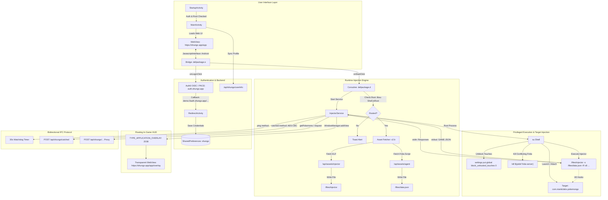

# Shungo Android Application Architecture & Reverse Engineering Report

**Target Artifact:** `shungo1.7.2.apk`  
**Package Name:** `com.shungo.app`  
**Version:** `1.7.2` (VersionCode `172`)  
**Target Platform:** Android (Min SDK 26 / Android 8.0, Target SDK 36 / Android 16)  
**Analysis Date:** October 2026  
**Methodology:** Static Decompilation (JADX, Apktool), Binary Structural Parsing, Cryptographic Analysis, IPC Protocol Reconstruction.

---

## 1. Executive Summary

Shungo (`com.shungo.app`) is a specialized companion, overlay, and automation utility targeting **Pokémon GO** (`com.nianticlabs.pokemongo`). The application combines a hybrid Android WebView user interface with a sophisticated root-level runtime code injection architecture.

Crucially, **no native shared libraries (`.so` files) are bundled inside the APK package**. Instead, the application implements a dynamic remote payload staging design:
1. It validates device root status using topjohnwu's `libsu` library.
2. It queries a central REST API (`https://shungo.app/api/assets/injector`) to dynamically retrieve architecture-specific (32-bit vs. 64-bit) native ELF executables (`frida-inject`), saving them to internal app storage.
3. It fetches an encrypted or obfuscated JavaScript hooking agent from `/api/assets/agent`, stored on disk under the deceptive filename `data.json`.
4. It executes a privileged root shell (`su`) to spawn or attach to the target game process (`com.nianticlabs.pokemongo`), injecting the Frida runtime (`-R v8`) with live game parameter overrides.
5. Communication between the injected game runtime and the Android application layer occurs through a bidirectional stream protocol over standard I/O streams using prefixed JSON payloads (`[GAME]`), with telemetry and caught event data protected by client-side PBKDF2/AES-CBC-256 encryption.

---

## 2. APK Identification & Cryptographic Integrity

### 2.1 File Characteristics
| Property | Value |
| :--- | :--- |
| **Filename** | `shungo1.7.2.apk` |
| **File Size** | `2,570,932` bytes (2.45 MB) |
| **MIME Type** | `application/vnd.android.package-archive` / `application/zip` |
| **SHA-256** | `2b1361837ac2a85722286c73142a1cb06094c1d1b05a7ea212a0b0eb909059fe` |
| **SHA-1** | `da2998a44b8a4f107b304c4f3ce376b3f7f183c5` |
| **MD5** | `5100084f7b60098df49688bc8a4d46ad` |

### 2.2 Manifest & SDK Target
| Attribute | Configured Value |
| :--- | :--- |
| **Package Name** | `com.shungo.app` |
| **Version Code** | `172` |
| **Version Name** | `1.7.2` |
| **Minimum SDK** | `26` (Android 8.0 Oreo) |
| **Target SDK** | `36` (Android 16 / Vanilla Ice Cream preview) |
| **Compile SDK** | `36` |
| **Custom Permission** | `com.shungo.app.DYNAMIC_RECEIVER_NOT_EXPORTED_PERMISSION` (Signature) |

### 2.3 Signing Certificate & Security Block
The APK is signed exclusively using **APK Signature Scheme v2** (ID `0x7109871a`). Traditional JAR signing (v1 / `META-INF/*.RSA`) is omitted. The APK Signing Block spans offset `2500860` to `2509052` (8,184 bytes) and contains:
- **Scheme v2 Block (`0x7109871a`)**: Length 1,495 bytes.
- **Dependency Info Block (`0x504b4453` / `PKDS`)**: Length 4,481 bytes (encrypted AGP metadata).
- **Verity Padding Block (`0x42726577` / `Brew`)**: Length 2,160 bytes.

**Certificate Metadata:**
- **Subject / Issuer:** `CN=abc, OU=def, O=ghj, L=acd, ST=adc, C=adc` (Self-signed developer certificate)
- **Serial Number:** `0x1a977628` (446,133,800)
- **Validity:** `2023-07-17 17:54:09 UTC` to `2123-06-23 17:54:09 UTC` (100-year validity)
- **Certificate SHA-256:** `dddf8cd5ba499fb1a7acd0f9fd095d034152445fa3f59a9b0801fc7b1537f4f4`
- **Certificate SHA-1:** `9f1d225e7bd143a17cc7ef5849913966a9dbf438`

---

## 3. Package Contents & Architecture Inventory

```
shungo1.7.2.apk
├── AndroidManifest.xml
├── classes.dex                     (1.64 MB, 1,835 classes, 13,849 methods)
├── resources.arsc                  (992 KB compiled resource table)
├── res/                            (Layouts, drawables, values)
│   ├── layout/activity_main.xml    (WebView UI container)
│   └── layout/overlay_webview.xml  (Transparent system overlay layout)
├── assets/
│   ├── logo.png                    (App icon asset)
│   ├── main.jar                    (3.6 KB, embedded DEX: libsu RootServerMain)
│   └── dexopt/
│       ├── baseline.prof           (ART AOT profile)
│       └── baseline.profm          (ART profile metadata)
└── META-INF/                       (AndroidX and Kotlin runtime version descriptors)
```

### 3.1 DEX File Inventory
1. **Primary DEX (`classes.dex`):**
   - **Header Magic:** `dex\n038\0`
   - **Size:** `1,721,572` bytes
   - **SHA-256:** `13414302d2958d944974ac6035b2b20ce8fc3d8817fe3c8ce051a8ecc921500d`
   - **Strings:** 10,460 | **Types:** 2,724 | **Prototypes:** 3,355
   - **Fields:** 6,402 | **Methods:** 13,849 | **Class Definitions:** 1,835
2. **Secondary Stored DEX (`assets/main.jar`):**
   - **Header Magic:** `dex\n035\0`
   - **Size:** `6,652` bytes
   - **SHA-256:** `3594df0b03e7c7e42b9156a4977517ff7f4d52064fa08fce80a62c108883e9fa`
   - **Class Definitions:** 5 (`com.topjohnwu.superuser.internal.RootServerMain`, `a`, `b`, `c`, `d`)
   - **Purpose:** Standalone Java entry point used by `libsu` when running privileged root service daemons across process boundaries.

### 3.2 Native Library (`lib/`) Analysis
- **Embedded Shared Objects:** None. The APK contains zero `.so` files across all ABI directories (`armeabi-v7a`, `arm64-v8a`, `x86`, `x86_64`).
- **Dynamic Native Fetching:** The native binary is fetched during runtime startup from:
  `GET https://shungo.app/api/assets/injector?injector=<main64bit|main32bit|experimental64bit>&md5=<cached_md5>`
- **Local Storage Path:** `/data/data/com.shungo.app/files/injector` (marked executable via `chmod +x`).

---

## 4. Application Component Architecture



---

## 5. Detailed Component Breakdown

### 5.1 Entry Points & Manifest Declarations
1. **`com.shungo.app.StartupActivity`**:
   - Registered as `MAIN` / `LAUNCHER`.
   - On Android 13+ (API 33+), prompts for `POST_NOTIFICATIONS`.
   - Starts log capture process (`u2.n`) writing to `/files/logs/shungo.log`.
   - Asynchronously acquires a background `libsu` root shell (`y2.d.b(...)`).
   - On shell callback, navigates to `MainActivity` and finishes.

2. **`com.shungo.app.MainActivity`**:
   - Hosts full-screen `WebView` (`R.id.webview`).
   - Enforces Chromium WebView version >= 111 (verifies via `WebView.getCurrentWebViewPackage()` or UA regex `Chrome/(\d+)`; alerts user to update from Play Store if outdated).
   - Configures Auth0 authentication client (`auth.shungo.app`, client ID `gS2scb6i4R8DI3SbzYZqZPQdTsl63r9g`).
   - Exposes JavaScript bridge object `Android` via `defpackage.e`.
   - Handles deep links: `https://shungo.app/configs/*` triggers JS callback `handleDeepLink("duplicateConfig", "<id>")`.

3. **`com.shungo.app.InjectorService`**:
   - `Service` declared with `android:foregroundServiceType="specialUse"`.
   - Maintains continuous foreground notification under channel `foreground_service_channel`.
   - Spawns background worker thread managing privileged `su` process execution.
   - Manages floating in-game HUD overlay via `WindowManager`.
   - Handles proximity sensor power saving and watchdog monitoring.

4. **`com.auth0.android.provider.RedirectActivity` & `AuthenticationActivity`**:
   - Receives PKCE redirect callbacks on `demo://auth.shungo.app/android/com.shungo.app/callback`.

---

## 6. Implementation Deep-Dive

### 6.1 JavaScript-to-Native Bridge (`defpackage.e`)
The bridge exposes 11 methods to web content:

| JavaScript Interface Method | Invocation Action |
| :--- | :--- |
| `DownloadUpdate(url)` | Enqueues update download in `DownloadManager` targeting `Download/shungo.apk`. |
| `SaveLogs()` | Grants storage permissions via root (`pm grant ...`), aggregates logs from `/files/logs/shungo.log` or runs `logcat -d -t 5000`, copies output to `/sdcard/shungologs.txt`. |
| `SaveSettings(settingsJson)` | Persists configuration JSON into SharedPreferences `shungo` under key `settings`. |
| `copyToClipboard(text)` | Copies string to Android `ClipboardManager`. |
| `hasOverlayPermission()` | Returns `Settings.canDrawOverlays(context)`. |
| `requestOverlayPermission()` | Fires Intent `android.settings.action.MANAGE_OVERLAY_PERMISSION`. |
| `onDowngradeArtClick()` | Executes root command: `pm uninstall com.google.android.art && reboot` (reverts Android ART APEX updates to maintain Frida hook compatibility). |
| `onLoginClick()` | Launches Auth0 PKCE WebAuth flow requesting scopes: `openid profile email offline_access`. |
| `onLogoutClick()` | Clears Auth0 credentials and invokes JS `onLogout()`. |
| `onStartClick()` | Initiates root check, dependency update, and starts `InjectorService`. |
| `onStopClick()` | Terminates `InjectorService` and removes floating overlay. |

### 6.2 Remote Asset Synchronization (`v2.b` & `w2.d`)
Before injection, Shungo validates its local toolchain against the backend:
1. **Architecture Detection:** Evaluates `h.l1()`:
   - 64-bit device (`arm64-v8a`): queries `injector=main64bit` (or `experimental64bit`).
   - 32-bit device (`armeabi-v7a`): queries `injector=main32bit` (or `experimental32bit`).
2. **Injector Download:**
   - Sends: `GET /api/assets/injector?device=<android_id>&injector=<arch>&md5=<stored_md5>`
   - Response: `{"needUpdate": boolean, "url": string, "md5": string}`
   - If update needed: downloads ELF binary via OkHttp, writes to `/data/data/com.shungo.app/files/injector`, sets permissions `chmod +x`.
3. **Agent Script Download:**
   - Sends: `GET /api/assets/agent?device=<android_id>&manufacturer=<MANUFACTURER>&model=<MODEL>`
   - Headers: `Authorization: Bearer <auth0_token>`, `Token: <id_token>`, `version: 1.7.2`
   - Response payload is saved directly to `/data/data/com.shungo.app/files/data.json`.

### 6.3 Privilege Escalation & Injection Mechanism
When `InjectorService.onCreate()` runs:
1. **Touch Filter Override:**
   ```bash
   settings put global block_untrusted_touches 0
   ```
   *Rationale:* Android 12+ drops touches passing through overlays with `FLAG_NOT_TOUCHABLE`. Disabling `block_untrusted_touches` ensures tap events reach the underlying Pokémon GO canvas while the overlay is visible.
2. **Frida Conflict Mitigation:**
   ```bash
   fs=$(pidof frida-server) && echo "frida-server cmd: $(tr '\0' ' ' < /proc/${fs%% *}/cmdline)" && kill $fs
   ```
   *Rationale:* Prevents port and ptrace conflicts between standalone `frida-inject` and system `frida-server`.
3. **Target Execution Modes:**
   - **Spawn Mode (`injectionMode == "spawn"`):**
     ```bash
     am force-stop com.nianticlabs.pokemongo
     /data/data/com.shungo.app/files/injector -f com.nianticlabs.pokemongo -s /data/data/com.shungo.app/files/data.json -R v8 -i -P '{"settings":{...},"gameVersion":"...","lastActions":{...}}'
     ```
   - **Attach Mode (`injectionMode == "attach"`):**
     ```bash
     am start -n com.nianticlabs.pokemongo/<activity> -W -S
     sleep <injectionDelayMs>
     pid=$(pidof com.nianticlabs.pokemongo)
     /data/data/com.shungo.app/files/injector -p `pidof com.nianticlabs.pokemongo` -s /data/data/com.shungo.app/files/data.json -R v8 -i -P '{"settings":{...},"gameVersion":"...","lastActions":{...}}'
     ```

### 6.4 Bidirectional Inter-Process Communication (IPC) Protocol
The injector process streams telemetry from the game process over stdout/stderr. Lines prefixed with `[GAME]` contain JSON commands routed into `InjectorService.c(String str)`:

```
[GAME]{"method": "<METHOD_NAME>", "payload": { ... }}
```

1. **Method `"ping"`:**
   - Heartbeat sent periodically by the injected Frida script.
   - Updates `this.f1641i = System.currentTimeMillis()`.
   - A `Timer` running every 30,000 ms checks for timeouts; if elapsed time > 30s, the watchdog forcibly destroys the injector process (`process.destroyForcibly()`) and restarts the foreground service.
2. **Method `"catched"`:**
   - Sent when a Pokémon catch sequence succeeds.
   - Extracts `caughtInfo`: `{ by: string, at: long, latitude: double, longitude: double }`.
   - **Payload Encryption:**
     - Key derivation: `PBKDF2WithHmacSHA1`, 10,000 iterations, 256-bit key length.
     - Passphrase: `"1.7.2ui+DPh8lIlBxya5XVsmeDCoUl6vHhdIESMB6sQ="`
     - Salt: `"AiF4sa12SAfvlhiWu"` (Base64 decoded from `QWlGNHNhMTJTQWZ2bGhpV3U=`)
     - Cipher: `AES/CBC/PKCS7Padding`
     - IV: `"mT34SaFD5678QAZX"` (Base64 decoded from `bVQzNFNhRkQ1Njc4UUFaWA==`)
   - Dispatches encrypted string via HTTP POST to `/api/shungo/catched`.
   - Caches coordinate history in SharedPreferences `lastActions`.
   - Writes the HTTP response code back to the injector stdin: `code}`.
3. **Method `"getPokemons"`:**
   - Relays queries to `/api/shungo/pokemons?<query>` with Bearer auth headers.
   - Streams JSON response directly back to injector via stdin.
4. **Method `"request"`:**
   - Acts as an authenticated HTTP gateway for the injected Frida runtime.
   - Allows the injected script inside Pokémon GO to issue arbitrary requests (`path`, `query`, `body`) via the Android app's established OkHttp3 session without managing separate network credentials.

### 6.5 Floating HUD & Power Management
1. **Overlay Configuration:**
   - Type: `WindowManager.LayoutParams.TYPE_APPLICATION_OVERLAY` (`2038`).
   - Flags: `56` (`FLAG_NOT_FOCUSABLE` | `FLAG_NOT_TOUCHABLE` | `FLAG_NOT_TOUCH_MODAL`).
   - Format: `PixelFormat.TRANSLUCENT` (`-2`).
   - Alpha: `0.99f` (evades certain window-detection filters).
   - Loads URL: `https://shungo.app/app/overlay`.
   - Client injection: injects `document.body.style.backgroundColor = 'transparent'` and passes settings via `setSettings(...)`.
2. **Proximity Pocket Power Saving:**
   - If `proximitySensor` setting is enabled, registers `SensorEventListener` for `Sensor.TYPE_PROXIMITY` (`8`).
   - When covered, acquires `PowerManager.PROXIMITY_SCREEN_OFF_WAKE_LOCK` (`32`, tag `"shungo:app"`), turning off the physical screen while keeping CPU and injection running.

---

## 7. Third-Party Dependencies

| Library / Framework | Package Namespace | Role & Significance |
| :--- | :--- | :--- |
| **Auth0 Android SDK** | `com.auth0.android` | OAuth2 / OpenID Connect authentication with PKCE. |
| **Square OkHttp** | `okhttp3` | Core HTTP/2 network transport, connection pooling, and SSL handling. |
| **Google Material 3** | `com.google.android.material` | Material Design UI widgets and dialogs. |
| **Google Gson** | `com.google.gson` | JSON serialization and reflection mapping. |
| **topjohnwu libsu** | `x2.*`, `y2.*`, `assets/main.jar` | Magisk / KernelSU / APatch root shell management and IPC daemon. |
| **KotlinX Coroutines** | `kotlinx.coroutines` | Asynchronous task scheduling and IO dispatching. |
| **AndroidX Core / App** | `androidx.core`, `androidx.appcompat` | Android backward-compatibility framework. |

---

## 8. Analysis Artifacts Generated

All decompiled source files, extracted binaries, and artifacts have been generated in the project workspace:
- `/root/shungoRe/shungo1.7.2.apk`: Original validated APK.
- `/root/shungoRe/classes.dex`: Extracted primary DEX file.
- `/root/shungoRe/main_jar_classes.dex`: Extracted DEX from `assets/main.jar`.
- `/root/shungoRe/apktool_out/`: Apktool disassembly (decoded resources, smali, manifest).
- `/root/shungoRe/jadx_out/`: Complete JADX decompiled Java source tree.
- `/root/shungoRe/jadx_main_jar/`: Decompiled source of `main.jar` (libsu RootServerMain).
- `/root/shungoRe/SHUNGO_REVERSE_ENGINEERING_REPORT.md`: This comprehensive report.

---

## 9. Technical Limitations & Unresolved Questions

1. **Server-Side Staged Payloads (`injector` & `data.json`):**
   - The native injection binary (`frida-inject`) and the JavaScript game hooks (`data.json`) are dynamically retrieved from `https://shungo.app/api/assets/*` only upon valid Auth0 authentication.
   - While the command-line parameters, V8 runtime invocation, IPC protocol, and cryptographic keys were completely recovered from static analysis, recovering the active JavaScript hook logic requires live authenticated sessions.
2. **Git Repository Push Access:**
   - The remote target repository `https://github.com/AkaneSakuramori/shungoRe.git` returned `HTTP 403: Permission to AkaneSakuramori/shungoRe.git denied to adarshdubey-alphabotz`.
   - All code, decompiled trees, analysis outputs, and documentation have been committed locally to branch `main` in `/root/shungoRe`. Once collaborator access or credentials for `AkaneSakuramori` are configured, the changes can be pushed with `git push origin main`.
